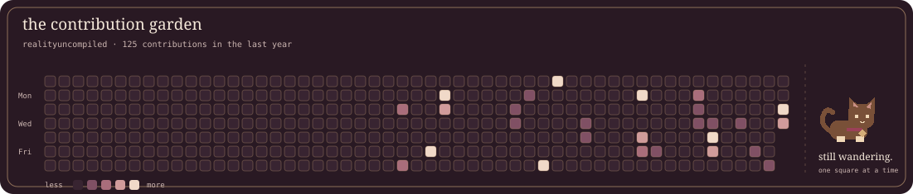

<table>
<tr>
<td width="34%" align="center">

</td>
<td width="66%" align="left">

# realityuncompiled

<em>Somewhere between curiosity and a questionable sequence of events.</em>

Software Engineering student · Professional wanderer · **Master of questionable decisions**

<a href="https://github.com/realityuncompiled?tab=repositories">Repositories</a> ·
<a href="https://github.com/realityuncompiled">Profile</a>

</td>
</tr>
</table>

---

### 01. a rather informal introduction

Meow… I'm glad you're at my profile.

Visit on your own while I dive behind the bookshelf.

I'm a Software Engineering student at the Islamic University of Technology, currently navigating the rather interesting business of learning how to make computers do things — preferably things I intended them to do.

I'm interested in software engineering, AI, cybersecurity, digital privacy, and research… Or, to be honest, I'm still stuck wandering.

I enjoy building small things, investigating unfamiliar concepts, and occasionally turning an innocent idea into an unnecessarily elaborate experiment.

I haven't quite figured out where all these interests are leading. For now, I'm rather enjoying finding out.

I like understanding what's happening beneath the surface. Not particularly fond of knowing that something works without knowing *why* it works. Which, admittedly, makes some learning experiences considerably longer than anticipated.

This profile is a record of some of that wandering.

---

### 02. the workbench

*Things I've built, things I'm building, and things that have yet to cooperate.*

<table>
<tr>
<td width="30%">
<strong><a href="https://github.com/realityuncompiled/cram-jam">Cram Jam</a></strong>
</td>
<td>
Offline academic-pressure tracker built with Python, SQLite and Streamlit. Born out of forgetting deadlines, quizzes and other academic incidents until they become considerably less forgettable.
</td>
</tr>

<tr>
<td>
<strong><a href="https://github.com/realityuncompiled/half-human-half-stackoverflow">half-human-half-stackoverflow</a></strong>
</td>
<td>
A collection of programming experiments, exercises, C programs, Java experiments and a Cairo smart-contract experiment. Evidence of learning in progress.
</td>
</tr>

<tr>
<td><strong>Chai Ledger</strong></td>
<td>
<em>Currently brewing.</em> A CLI-based exploration of OOP and transaction tracking. Because apparently even a cup of tea can require accounting.
</td>
</tr>
</table>

---

### 03. things currently occupying my terminal

*An incomplete inventory. Subject to change without notice.*

| Technology | Relationship |
|:---|:---|
| C | Learning and experimenting |
| C++ | Exploring |
| Java | Learning |
| Python | Building projects |
| C# | Learning |
| SQL | Learning |
| MIPS | Academic exploration |
| Git | Version control and collaboration |
| Linux | Daily exploration |

Also interested in AI, cybersecurity, privacy engineering, and the occasional rabbit hole that has absolutely nothing to do with the original task.

I prefer understanding the machinery over memorising which buttons to press.

---

### 04. the contribution garden

*An actual record of activity, not a decorative approximation.*

Each square represents an actual contribution day. Empty days stay empty. The cat is just visiting.

The little incidents lead to '…', don't they?

---

### 05. a cabinet of curiosities

*For things that need not be useful to be worth keeping.*

There are stories one finishes, and stories that quietly rearrange the furniture in one's head.

I have a particular weakness for the latter.

Old books, uncomfortable questions, psychological thrillers, fictional worlds that linger a little too long, and characters whose decisions would make excellent case studies in questionable human behaviour.

Sometimes it's a novel. Sometimes it's a film. Sometimes it's an anime. Sometimes it's a BL that turns out to have considerably more going on beneath the surface than its description suggested.

I also draw, collect visual ideas, appreciate peculiar music, and have a fondness for things that are simultaneously a little gloomy and a little whimsical.

- **The bookshelf:** old stories, difficult questions, and other occupants of a rather crowded mind.
- **The moving pictures:** psychological mysteries, unsettling narratives, and stories with an excellent sense of atmosphere.
- **The little worlds:** fictional characters, strange universes, and the occasional emotional catastrophe.
- **The margins:** art, music, observations, and things I probably should have written down somewhere.

---

### 06. an unofficial lexicon

*Words have failed. Replacements have been issued.*

| Expression | Meaning |
|:---|:---|
| thing-a-magic | A technical object whose proper name has temporarily escaped me. |
| proly | Probably, with a little less commitment. |
| Y'know like… | An explanation is approaching. Its route is uncertain. |
| Lesgooo | Readiness. Actual preparedness may vary. |
| BRO. | A universal response to particularly significant incidents. |
| Meow | No further explanation required. |

Ugly truths are honest.

---

### 07. before you leave

Thanks for wandering around.

If something here caught your attention, feel free to explore the repositories, open an issue, or say hello.

I'm still learning, still experimenting, and occasionally making a thing-a-magic out of something that probably had a perfectly reasonable name.

The cat has gone somewhere behind the bookshelf again.

I suspect it found another project.

<em>Still wandering. Still wondering.</em>

 

— realityuncompiled

